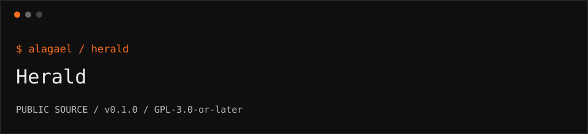

<p></p>

# Herald

Encrypted letters requiring both a future drand beacon and a threshold of Keeper shares to open.

```text
repository   github.com/alagael/herald
release      0.1.0 / public beta
audit        not independently audited
support      support@alagael.xyz
```

## What ships

An ESM encrypted-letter library with two independent opening conditions:

```text
letter
  -> AES-256-GCM with a fresh random key
  -> drand time-lock encryption for a future round

AES key
  -> threshold SLIP-39 Keeper shares

open = valid beacon for the chosen round AND enough Keeper shares
```

It is a time-and-threshold gate, **not automatic proof of death**. A published valid beacon can be used after the round; the library cannot prove that a person has died.

## Build and test

```sh
git clone https://github.com/alagael/herald.git
cd herald
pnpm install --frozen-lockfile
pnpm run build
pnpm test
node examples/inspect-round.mjs
pnpm pack
```

Node.js 22+ and pnpm 10.17.1 are required. Build output is `dist/index.js` and TypeScript declarations. Tests use known public beacon fixtures and synthetic letters, not production secrets or funds.

## Usage

```js
import { sealLetter, openLetter, PinnedChainClient } from "./dist/index.js";

const client = new PinnedChainClient();
const result = await sealLetter({
  letter: "Disposable demonstration only.",
  opensAt: new Date(Date.now() + 24 * 60 * 60 * 1000),
  threshold: 2,
  keepers: 3,
  client
});
// Store result.sealed separately; distribute result.shares privately.
// After the required round is available:
// const text = await openLetter({ sealed: result.sealed, shares: twoKeeperShares, client });
```

Use UTC when displaying dates. `roundForDate` selects the first round at or after the requested time. `inspectSealed` reads public envelope metadata without opening the letter. `PinnedChainClient` uses pinned drand quicknet chain parameters and verifies beacon signatures.

## Trust and privacy

Cryptographic processing takes place locally. The default client requests public randomness beacons from remote relays; those requests can expose network metadata and the requested round. A manual beacon provider is available through the constructor.

Keepers can collude once the beacon is available. If the selected drand network stops producing beacons before the target round, the letter may remain inaccessible. Back up the sealed envelope, shares, format documentation, and a compatible recovery tool. JavaScript cannot guarantee complete removal of plaintext from memory.

No seed phrase or private wallet key is required to seal a letter. Never put live secrets in examples or support reports.

## Story and licenses

Alagael and the Heralds appear in [Snowmoon, Chapter 6](https://vitalik.eth.limo/snowmoon/html/chapter-6.html). They provide transparency after retirement from power. The encrypted-letter mechanism here is an independent software adaptation, not a protocol specified or endorsed by Vitalik.

Own source is GPL-3.0-or-later. Bundled code retains its original licenses and documented patches: [THIRD_PARTY_NOTICES](THIRD_PARTY_NOTICES.md).

## Participate

[CONTRIBUTING](CONTRIBUTING.md) · [SECURITY](SECURITY.md) · [RELEASING](RELEASING.md)
